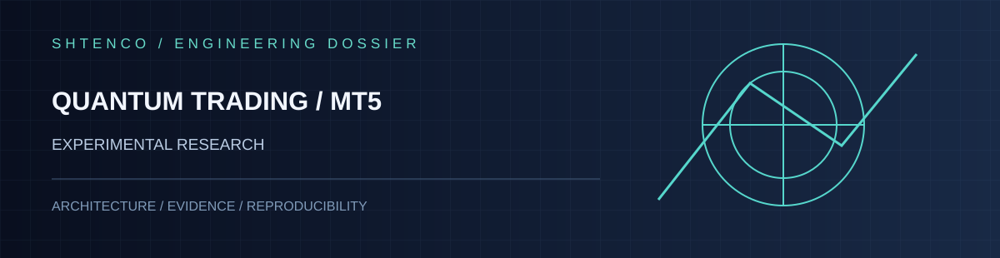
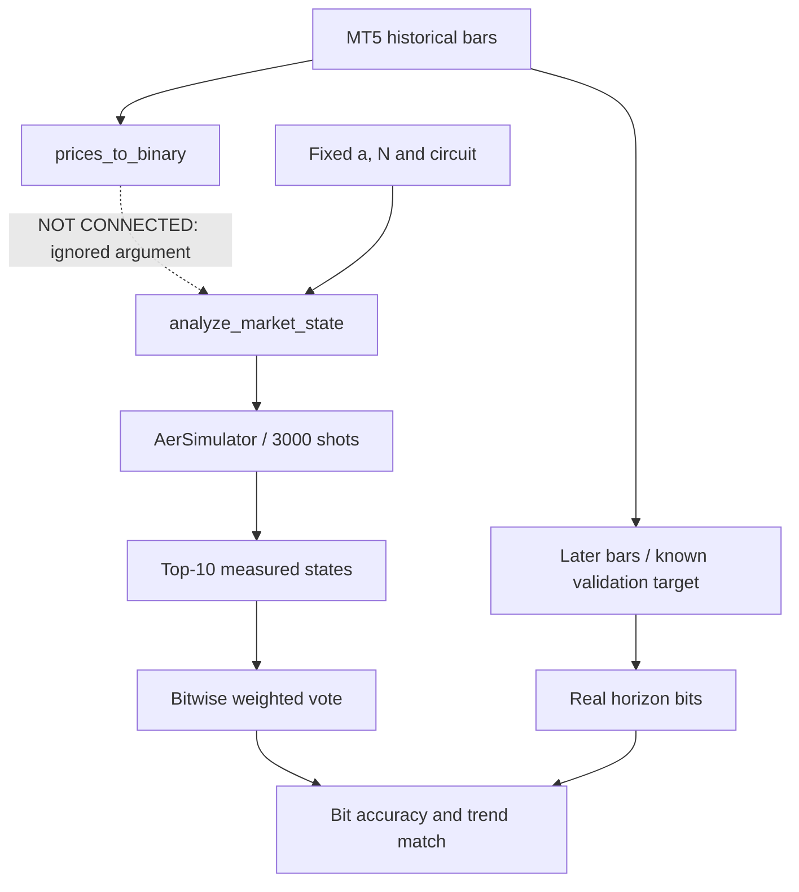

<div align="center">



**Quantum Trading / MetaTrader 5**

Исследование квантовых вычислительных схем, бинарных временных рядов и предиктивной валидации на валютном рынке.

[Постановка](#исследовательская-задача) · [Реализация](#фактически-реализованный-алгоритм) · [Математика](#математическая-модель) · [Верификация](#научная-оценка-и-критическая-граница) · [Запуск](#воспроизведение) · [План](#план-исследований)

</div>

> **Статус: экспериментальный алгоритмический прототип.** Код реализует сбор D1-котировок MT5, бинаризацию, фиксированную фазовую квантовую цепь Aer и сравнение полученных битов с историческим future horizon. Текущая цепь **не зависит от входной рыночной последовательности**, поэтому доказательств прогноза рынка или quantum advantage нет.

## Исследовательская задача

Проект ставит содержательный вопрос: можно ли кодировать причинно доступную историю финансового инструмента в квантовое состояние, применять измеримый квантовый оператор и получать более качественную оценку будущего распределения изменений цен по сравнению с сильной классической моделью той же вычислительной стоимости?

Его инженерная ценность сегодня — исходный код соединения рыночной временной шкалы с квантовым симулятором, структура измерений и конкретный список гипотез для опровержимой экспериментальной программы. Ни успешное определение будущей цены, ни положительная торговая доходность данной реализацией пока не установлены.

## Фактически реализованный алгоритм

| Этап | Функция в `main.py` | Реальная операция |
|:--|:--|:--|
| Данные | `initialize_mt5`, `get_price_data` | Подключение MT5 и получение `copy_rates_from_pos` |
| Кодирование | `prices_to_binary` | Бит 1 для роста соседнего close, 0 иначе; выравнивание слева до 256 |
| Цепь | `qpe_dlog` | Подготовка Hadamard, controlled-phase, обратноподобное преобразование и измерение |
| Исполнение | `analyze_market_state` | AerSimulator, 3000 shots, наиболее частое состояние |
| Эвристика | `predict_horizon` | Голосование битов десяти наиболее частых измеренных состояний |
| Истинная цель | `calculate_future_horizon` | Знак десяти последовательных будущих изменений (по умолчанию) |
| Сравнение | `compare_horizons` | Совпадение преобладающих BULL/BEAR-битов |



**Критический факт исходного кода:** `analyze_market_state(price_binary, num_qubits=22)` получает `price_binary`, однако далее использует лишь фиксированные `a = 70000000`, `N = 17000000`, `num_qubits` и генератор случайных измерений Aer. Ни одного обращения к `price_binary` внутри функции нет. Таким образом, разные рыночные истории формируют одинаковую распределённую процедуру измерения с точностью до случайности симулятора.

## Математическая модель

Для закрытий `C_t` бинарная история определяется как

```text
b_t = 1, если C_t > C_(t-1);
b_t = 0, иначе.
```

Оценка будущего горизонта длины H:

```text
y_(t+j) = 1[C_(t+j) > C_(t+j-1)],   j = 1, ..., H.
```

В `qpe_dlog` задаются фазы controlled-phase, зависящие от

```text
phi_q = 2*pi*((a^(2^q) mod N))/N.
```

Это описание фактической операции схемы; оно **не является математическим доказательством**, что схема решает discrete logarithm или воспроизводит корректный стандартный QPE-алгоритм. Для последнего требуются корректный unitary/eigenstate target, вывод распределения измерений и контрольная проверка на известных задачах.

Голосование по топ-10 состояниям:

```text
w_(i,1) = sum_{s in top10} (count(s)/shots) * 1[s_i=1]
w_(i,0) = sum_{s in top10} (count(s)/shots) * 1[s_i=0]
prediction_i = 1[w_(i,1) > w_(i,0)]
```

Поскольку `top10` может охватывать лишь часть counts, `w_(i,1)+w_(i,0)` обычно меньше 1. Эти величины — **не калиброванные вероятности**. Также битовое сравнение не измеряет trading PnL, Sharpe, drawdown или статистическую значимость.

## Научная оценка и критическая граница

**Основная нулевая гипотеза:** после фиксации схемы и процедуры измерений распределение `prediction` не зависит от `price_binary`.

Она непосредственно следует из проверенного потока параметров в `main.py`. Для устранения этого ограничения недостаточно увеличить `shots` или `num_qubits`: необходимо явно определить отображение `E(b_{0:t}) -> |psi_t>`, после которого квантовая операция реально зависит от истории.

**Остальные ограничения:**

1. Нет неизменяемого набора истории с идентификатором брокера, датами и контрольной суммой.
2. Нет фиксированных seeds симулятора и экспериментальных manifests.
3. Нет полноценного walk-forward, тестирования по нескольким OOS-периодам и доверительных интервалов.
4. Нет сравнения с majority class, persistence, Markov, logistic regression и другими matched baseline.
5. `prices_to_binary` заполняет слева нулями до 256 — при 256 свечах это 255 фактических переходов и один искусственный ведущий ноль.
6. Поле `horizon_point_time` обычно не появляется, поскольку данные MT5 не превращены в `DatetimeIndex`.
7. Длина горизонта должна валидироваться на положительность; иначе возможны пустые сравнения/деление на ноль.
8. Проверка не учитывает спред, своп, проскальзывание, комиссию и осуществимость исполнения.

## Архитектура исходников

| Файл | Назначение |
|:--|:--|
| [`main.py`](main.py) | Единственная реализация сбора данных, схемы и оценки |
| [`requirements.txt`](requirements.txt) | MT5, NumPy, Qiskit, Aer, PyCryptodome, pandas |
| [`docs/README_LEGACY.md`](docs/README_LEGACY.md) | Архив исходного исследовательского описания |
| [`assets/readme/hero.svg`](assets/readme/hero.svg) | Локальная векторная обложка |

Текущая структура не содержит отдельного `tests/`, CI с экспериментами, версионированных данных, checkpoint-артефактов или отчётов строгого независимого тестирования.

## Воспроизведение

Требуются Python и поддерживаемая ОС/установка MetaTrader 5. Версии библиотек в `requirements.txt` не закреплены. Пример начального запуска:

```bash
git clone https://github.com/Shtenco/quantum-trading_metatrader5.git
cd quantum-trading_metatrader5
python -m venv .venv
python -m pip install -r requirements.txt
python main.py
```

В интерактивном режиме задаются смещение и число прогнозируемых свечей. Предпочтительно использовать тестовый терминал/демо-среду. Успешный запуск в текущей среде не подтверждался.

## План исследований

| Фаза | Изменение | Критерий доказательства |
|:--|:--|:--|
| Q0 | Отделить получение данных от симулятора | Unit tests на детерминированных OHLC |
| Q1 | Реализовать рыночно-зависимый state encoding | Разные истории меняют подготовленное состояние |
| Q2 | Проверить математическую корректность quantum circuit | Отдельные известные тест-кейсы и сравнение с классической симуляцией |
| Q3 | Добавить фиксированные seeds, `shots`, `manifest.json` | Повторяемые распределения и контрольная сумма результатов |
| Q4 | Добавить walk-forward без заглядывания в будущее | Хронологический запечатанный OOS |
| Q5 | Провести ablation и matched classical baseline | Разница метрик с доверительными интервалами |
| Q6 | Добавить рынок исполнения и экономические издержки | Costed PnL, риск и устойчивость по режимам |

## Профессиональная ценность

Проект представляет собой прозрачную экспериментальную площадку на пересечении **квантовых цепей, численного моделирования, алгоритмов обработки временных рядов и систематической валидации**. На текущем этапе его сильная сторона — исследовательская постановка и реальный связующий исходный код; следующая необходимая научная цель — доказать, что рыночная информация действительно влияет на вычислительный результат и даёт измеримый прирост относительно честного классического контроля.

Ни прогнозная точность, ни quantum advantage, ни финансовая прибыль данным README не заявляются как достигнутые.

---

[SYNERGY SYSTEM](https://github.com/Shtenco/synergy_system) · [Исходный код](https://github.com/Shtenco/quantum-trading_metatrader5) · [Эталон оформления](https://github.com/Shtenco/synergy_eurasian)
